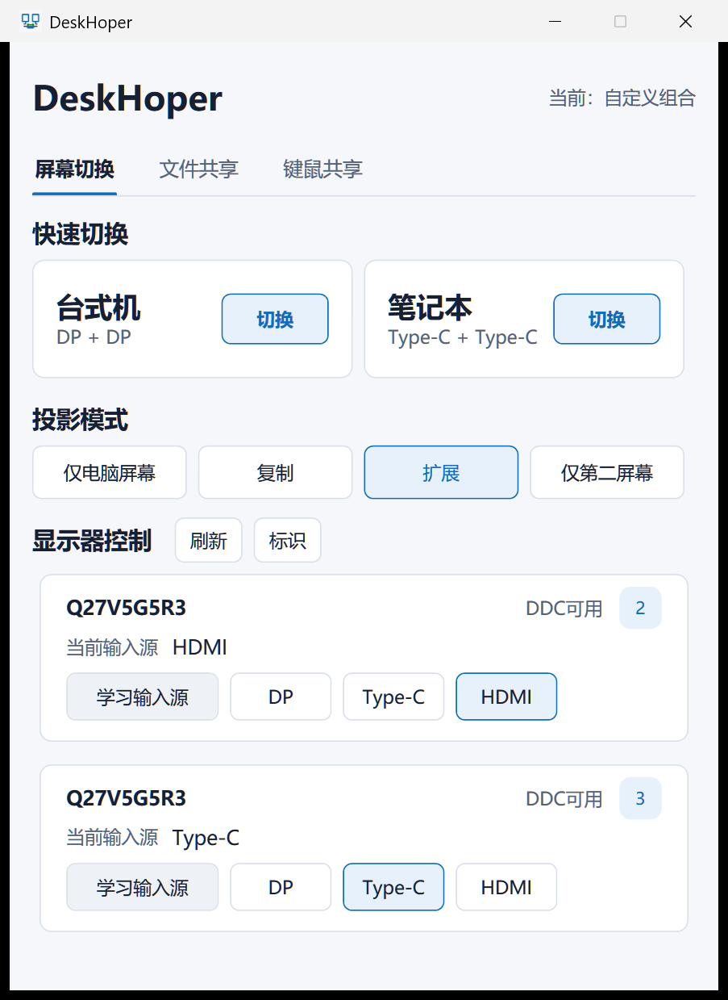
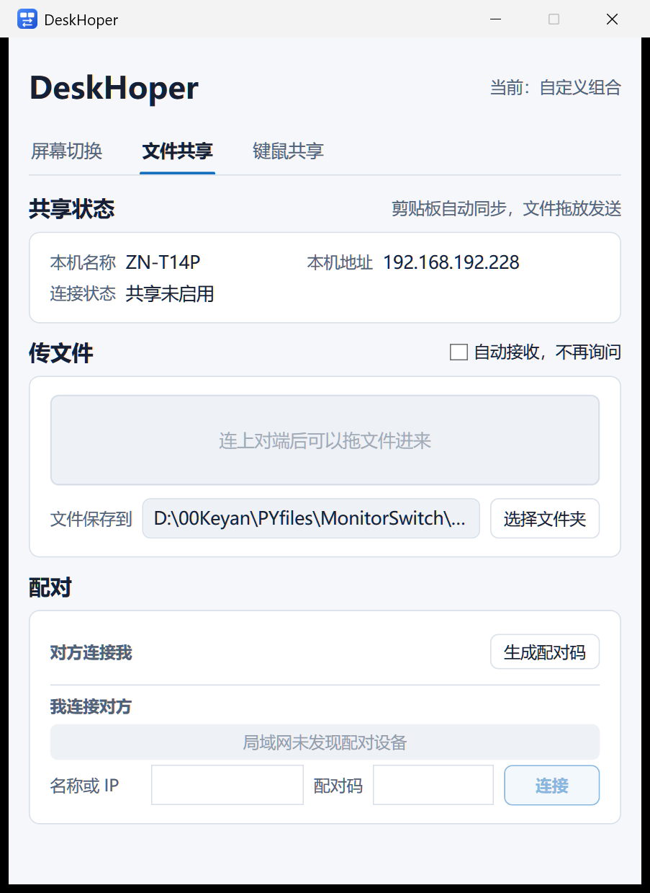
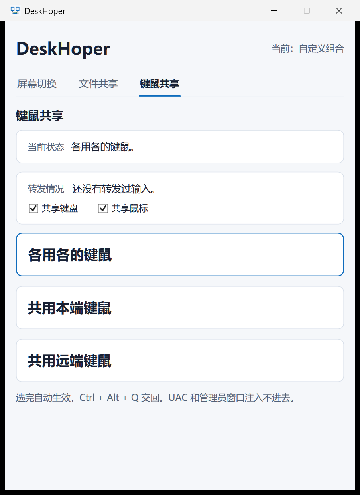
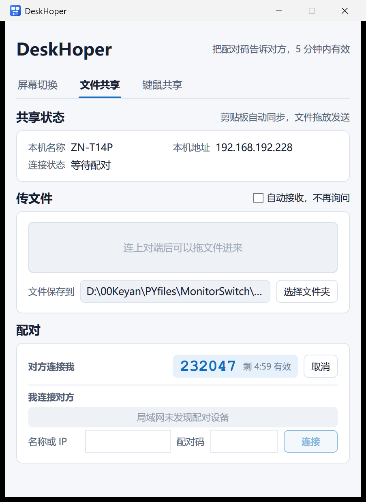

# DeskHoper

一台台式机 + 一台笔记本，共用同一套外接显示器、键盘和鼠标。DeskHoper 把这些收在一个窗口里：外接屏切给谁看、文件怎么过去、键盘鼠标归谁敲。

不需要装服务端，不需要账号。两台机器各跑一个 exe，在同一个局域网里就能用。

   [](https://github.com/zhengnan365/DeskHoper/releases/latest)



## 目录

- [解决什么问题](#解决什么问题)
- [下载与启动](#下载与启动)
- [界面与功能](#界面与功能)
  - [屏幕切换](#屏幕切换)
  - [文件共享](#文件共享)
  - [键鼠共享](#键鼠共享)
- [配对](#配对)
- [快捷键](#快捷键)
- [网络与安全](#网络与安全)
- [托盘与单实例](#托盘与单实例)
- [配置文件](#配置文件)
- [故障排查](#故障排查)
- [已知限制](#已知限制)
- [系统要求](#系统要求)
- [输入源学习](#输入源学习)
- [从源码构建](#从源码构建)
- [测试](#测试)
- [版本历史](#版本历史)
- [贡献](#贡献)
- [许可](#许可)

## 解决什么问题

外接显示器只有一套输入口，键盘鼠标也只有一套，但有两台电脑要用。传统做法是把线拔来拔去，或者买 KVM。DeskHoper 用软件解决其中一半问题：

| 需求 | 做法 |
| --- | --- |
| 外接屏切给另一台机器 | 通过 DDC/CI 直接改显示器的输入源，不动 Windows 的分辨率和排列 |
| 文本、文件传到另一台机器 | 局域网直连，文本复制即同步，文件靠拖放发送 |
| 一套键盘鼠标控制两台机器 | 拦截本机输入并转发给对面，随时一键交回 |

三件事互相独立，可以只用屏幕切换，也可以只用文件共享。

## 下载与启动

1. 到 [Releases](https://github.com/zhengnan365/DeskHoper/releases/latest) 下载 `DeskHoper-vX.Y.Z-win-x64.zip`。
2. **整个文件夹解压出来**，不要只拷 `DeskHoper.exe`——旁边有 5 个 WPF 原生 dll 必须一起带上。
3. 双击 `DeskHoper.exe`。self-contained 包，目标机不需要安装 .NET Runtime。**第一次双击会比以后慢很多**——实测同一份包，首次从启动到首屏就绪约 23 秒，第二次只要 2.2 秒。这 20 秒花在 Windows 首次读取并扫描这个 138 MB 的单文件 exe 上（包体不会解压到临时目录），不是程序卡住，别连点：单实例逻辑会把已经开着的窗口唤回，不会开出第二个。
4. 首次监听网络时 Windows 会弹防火墙授权，**两台机器都要勾选「专用网络」**，否则局域网发现列表是空的、手填 IP 也连不上。

程序没有安装步骤，不写注册表，不开机自启，没有后台服务。关掉程序 = 所有共享能力立即停止。

## 界面与功能

顶部三个菜单，三页共用同一个固定尺寸（516 × 708）的窗口，切页时高度不会跳。

### 屏幕切换

- **快速切换**：两张卡片对应两套接线（台式机 / 笔记本），点一下按每台显示器分别切到该卡片记录的输入源，当前生效的那张有蓝框和绿点。
- **投影模式**：仅电脑屏幕 / 复制 / 扩展 / 仅第二屏幕。
- **显示器控制**：逐台读取当前输入源，可单独切 DP / Type-C / HDMI。接线换了就点「学习输入源」重新认一遍；「标识」让屏幕闪编号，方便对上是哪一台。
- 显示器名字双击可改；卡片名字双击进入「编辑输入源和投影模式」。

### 文件共享



- **共享状态**：显示本机地址和对端连接状态。剪贴板文本复制即同步，不需要点任何东西。
- **传文件**：把文件拖进页面里的拖放区才发送。本机自己复制文件不会触发发送——复制文件和本机拷一份在剪贴板层面分不出来，「复制即发」必然误发。
- 收到的文件写进你指定的接收目录，同时写进本机剪贴板，可以直接粘进资源管理器。
- 收发都有进度：等待对端接收 → 发送中 / 接收中百分比 → 带文件数和总量的终态，显示在拖放区里，停 8 秒后自动收回。
- 同名不覆盖，只往接收目录里写新文件名。

### 键鼠共享



三张卡片，选哪张就等于选角色：

| 卡片 | 含义 |
| --- | --- |
| 各用各的键鼠 | 不拦截、不转发，两边互不影响 |
| 共用本端键鼠 | 这台当控制端，敲的键和滑的鼠标送到对面 |
| 共用远端键鼠 | 这台被控，接收对面的键鼠 |

在一台换卡片，对面会自动镜像成互补的那张，不用两台各点一次。键盘和鼠标是两个独立勾选，可以只共享鼠标。鼠标位移取自系统原始输入，不受 DPI 和多屏坐标换算影响。`Ctrl + Alt + Q` 随时把键鼠交回本机。

## 配对



1. 两台都打开 DeskHoper，停在**文件共享**页（局域网发现只在停着的时候收发广播）。
2. 一台点「生成配对码」，屏幕显示 6 位数字，5 分钟内有效。
3. 另一台在「我连接对方」里点它——同网段会自动出现在列表里，点一下就填好地址；也可以手填名称或 IP，然后输配对码。
4. 连上后配对这块自动收起，需要重新配对时断开即可。

## 快捷键

| 快捷键 | 作用 |
| --- | --- |
| `Ctrl + Alt + 1` | 切到台式机场景 |
| `Ctrl + Alt + 2` | 切到笔记本场景 |
| `Ctrl + Alt + Q` | 交回键盘鼠标 |

## 网络与安全

| 项 | 值 |
| --- | --- |
| 数据通道 | TCP `47810` |
| 局域网发现 | UDP `47811` |
| 加密 | TLS，自签证书并 pin SHA-256 指纹 |
| 配对 | 首次信任（TOFU），配对码一次性有效，5 分钟过期 |
| 中转 | 无。不经任何第三方服务器，数据只在两台机器之间直连 |

- **只走物理网卡**。本机地址和发现层的收发都限定在有线、无线这两类网卡上：Tailscale、Hyper-V、VMware 这类虚拟网卡各自编了一个内网段，对面拿那个地址回不来，所以既不会被当成本机地址显示，也不会出现在设备列表里。
- 发现列表被伪造最多是多出一条假设备，连过去仍然必须输对配对码。
- 局域网发现用 UDP 广播，**不能跨网段**。两台不在同一个网段时，先确认网络拓扑，或者换到有路由的网卡段。
- 传输上限：一次最多 200 个文件、总量 512 MB。

## 托盘与单实例

- 点关闭会让你选「隐藏到托盘」还是「退出程序」，选一次就记住。隐藏到托盘时窗口只是收起来，剪贴板同步、文件共享、键鼠转发和全局热键全部照常工作；退出才是真的全停。
- 托盘图标单击唤回窗口，右键菜单有切换到台式机 / 切换到笔记本 / 打开主界面 / 退出。
- 已经在跑（包括藏在托盘里）时再双击 exe，会把那个实例的窗口唤回前台，不会开出第二个。

## 配置文件

配置保存在 exe 旁边的 `DeskHoper-config` 目录，由程序首次运行时创建：

| 文件 / 目录 | 内容 |
| --- | --- |
| `profiles.json` | 切换场景（每台显示器的输入源 + 投影模式） |
| `monitors.json` | 每台显示器的输入映射、自定义名称、排序 |
| `settings.json` | 输入源默认映射、关闭时的行为等应用设置 |
| `peer.json` | 本机名称、已信任的对端指纹、接收目录、键鼠模式 |
| `接收文件/` | 默认接收目录，可由 `peer.json` 里的 `ReceiveDirectory` 改走 |
| `logs/` | 运行日志 `deskhoper-YYYYMMDD.log` |

删掉对应文件即可恢复该项配置。配置都是本地明文 JSON，不含账号信息。

## 故障排查

| 现象 | 先看这里 |
| --- | --- |
| 设备列表一直是空的 | 两台防火墙是否放行「专用网络」；是否都停在文件共享页；是否在同一个网段 |
| 本机地址看着不对 | 多半是虚拟网卡的段。程序只认物理网卡，仍不对就看日志里 `LAN discovery` 那几行 |
| 点了切换屏幕没反应 | 在显示器 OSD 菜单里确认 DDC/CI 已开启；卡片上标「DDC不可用」说明这台显示器不响应写入 |
| 切完显示「未知输入源」 | 输入源刚切完的一瞬间 DDC 可能读到瞬时值，过一会儿会自己校正 |
| 鼠标发飘、手感带曲线 | 对面关掉「提高指针精确度」，它的非线性曲线会叠加在转发位移上 |
| 键鼠转发失效 | 被控端弹了 UAC 提权窗，或目标窗口以管理员身份运行——普通权限进程注入不进去，页面上会显示错误 |
| 传文件报上限 | 单次 200 个文件、总量 512 MB，超了不会开始发送 |

排查优先看 `DeskHoper-config/logs/` 里当天的日志，收发、配对、DDC 读写结果都会记录。

## 已知限制

- 没有无界面模式：软件开着才生效，退出后剪贴板、文件、键鼠共享全部停止。
- 一次只支持两台机器，一对一。
- UAC 提权弹窗和以管理员身份运行的窗口注入不进去。
- 显示器不响应 DDC/CI 时只能读不能切。
- 局域网发现不能跨网段。

## 系统要求

- Windows 10 / 11，x64
- 支持 DDC/CI 的外接显示器，并且**显示器 OSD 菜单里已开启 DDC/CI**
- 文件共享和键鼠共享需要两台机器在同一个局域网内

软件用 .NET 8 WPF 开发，GitHub Release 提供 self-contained win-x64 包，正常情况下不需要单独安装 .NET Runtime。

## 输入源学习

不同品牌型号的显示器，DDC/CI 的 Input Select（VCP 0x60）取值并不一样。DeskHoper 不要求所有显示器用同一套值：学习结果**按每台显示器独立保存**，你学出来的值优先于内置的默认映射。当前主要在 AOC 显示器环境下开发和测试，实际支持情况取决于显示器型号、连接方式、显卡驱动和固件。

## 从源码构建

```powershell
dotnet build DeskHoper.sln
dotnet build DeskHoper.sln -c Release
dotnet publish DeskHoper.csproj -c Release -r win-x64 --self-contained true -p:PublishSingleFile=true -o publish\vX.Y.Z-win-x64
```

发布结果是 `DeskHoper.exe` + 5 个 WPF 原生 dll，**整个文件夹一起拷走**（原生 dll 留在 exe 旁边，运行时不再往临时目录解压）。多语言资源只保留 `zh-Hans`（写在 csproj 的 `<SatelliteResourceLanguages>` 里，不用命令行重复指定），省 14 MB。配置目录 `DeskHoper-config` 由程序首次运行时在 exe 旁边创建，不要打进发布包。

## 测试

回归测试是独立的控制台工程，不依赖测试框架：

```powershell
dotnet run --project DeskHoper.Tests/DeskHoper.Tests.csproj -c Debug
```

8 组契约测试：投影模式、逐台 Profile、显示器偏好与输入源学习、切换按钮编辑、配对与加密链路、文件传输与接收路径安全、键鼠转发闸门、只走物理网卡的地址选择。

## 版本历史

发布记录见 [Releases](https://github.com/zhengnan365/DeskHoper/releases)。版本号写在 `DeskHoper.csproj` 的 `<Version>`，每个发布打同名 git tag。

## 贡献

改代码前后各跑一次 `dotnet build DeskHoper.sln` 和上面那条测试命令，两边都要 0 警告、8 组全过。屏幕切换相关的改动需要一台真机加支持 DDC/CI 的外接显示器才能验证，纯代码评审测不出来。

## 许可

本项目采用 [MIT License](LICENSE) 开源。

免责说明：使用前请确认显示器已开启 DDC/CI。DDC/CI 读写失败时软件会保留错误状态而不会猜测结果，实际输入源请以显示器 OSD 和 Windows 显示设置为准。键鼠转发会拦截本机输入，请用 `Ctrl + Alt + Q` 交回，不要在被控端处于重要操作时开启。

---

郑在探索 · zhengnan.me@gmail.com · [www.znup.top](https://www.znup.top)
