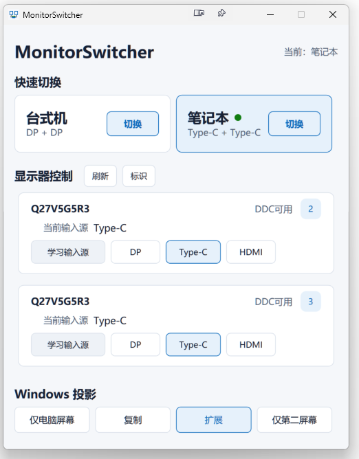

# MonitorSwitcher

一个用于 Windows 多显示器环境的轻量显示器输入源切换工具。

MonitorSwitcher 主要用于在台式机和笔记本之间快速切换外接显示器输入源，并集成 Windows 投影控制。

## v2.1.0

- Profile 右键支持“保存当前配置”，可将当前外接屏输入组合写回台式机或笔记本场景
- 当前 Profile 状态高亮与绿色状态点
- 外接显示器卡片支持 UI 内拖拽排序，不影响 Windows 显示器编号、拓扑或 Profile 关系
- 输入源学习、每台显示器独立映射与 HDMI 切换

发布包：`MonitorSwitcher-v2.1.0-win-x64.zip`，内含 self-contained 单文件版本，无需单独安装 .NET Runtime。

## 截图



## 功能

- 台式机 / 笔记本一键切换
- DisplayPort / USB-C / HDMI 输入源切换
- DDC/CI 显示器控制
- 输入源学习
- 每台显示器独立输入映射
- 显示器自定义名称
- 显示器标识
- Windows 投影模式切换：仅电脑屏幕、复制、扩展、仅第二屏幕
- 全局快捷键：Ctrl + Alt + 1 切换台式机，Ctrl + Alt + 2 切换笔记本
- Single Instance
- 自动检测当前输入状态
- Mixed Input 状态识别

## 系统要求

- Windows 10 / Windows 11
- x64
- 支持 DDC/CI 的外接显示器
- 显示器 OSD 中已开启 DDC/CI

软件使用 .NET 8 WPF 开发。GitHub Release 提供 self-contained win-x64 版本，正常情况下无需单独安装 .NET Runtime。

## 使用方法

1. 启动 MonitorSwitcher。
2. 点击“刷新”检测当前显示器。
3. 第一次使用时，通过“学习输入源”分别确认每台显示器的 DP、Type-C 和 HDMI 映射。
4. 设置完成后即可通过主界面或快捷键快速切换。

## 输入源学习

不同品牌和型号的显示器可能使用不同的 DDC/CI Input Select（VCP 0x60）值。MonitorSwitcher 不要求所有显示器使用固定输入值，学习结果会按每台显示器独立保存，用户学习值优先于已知默认映射。

## Windows 投影

MonitorSwitcher 可以调用 Windows Projection：

- 仅电脑屏幕
- 复制
- 扩展
- 仅第二屏幕

实际状态通过 Windows DisplayConfig 进行验证。

## 配置文件

用户配置保存在 EXE 所在目录的 `MonitorSwitcher-config` 文件夹，主要包括：

- `monitors.json`
- `profiles.json`
- `logs`

删除对应配置文件可以恢复相应配置。配置文件不包含在源码仓库和发布包之外的项目文件中。

## 支持的显示器

MonitorSwitcher 理论上适用于支持标准 DDC/CI Input Select VCP 的显示器，当前主要在 AOC 显示器环境下开发和测试。实际支持情况取决于显示器型号、连接方式、显卡驱动和显示器固件。

## Build

开发环境：.NET 8、WPF、Windows x64。

```powershell
dotnet build MonitorSwitch.sln
dotnet build MonitorSwitch.sln -c Release
dotnet publish MonitorSwitch.csproj -c Release -r win-x64 --self-contained true
```

## License

本项目采用 [MIT License](LICENSE) 开源。

## Disclaimer

使用前请确认显示器已开启 DDC/CI。DDC/CI 读写失败时，软件会保留错误状态；请以显示器 OSD 和 Windows 显示设置为准。
